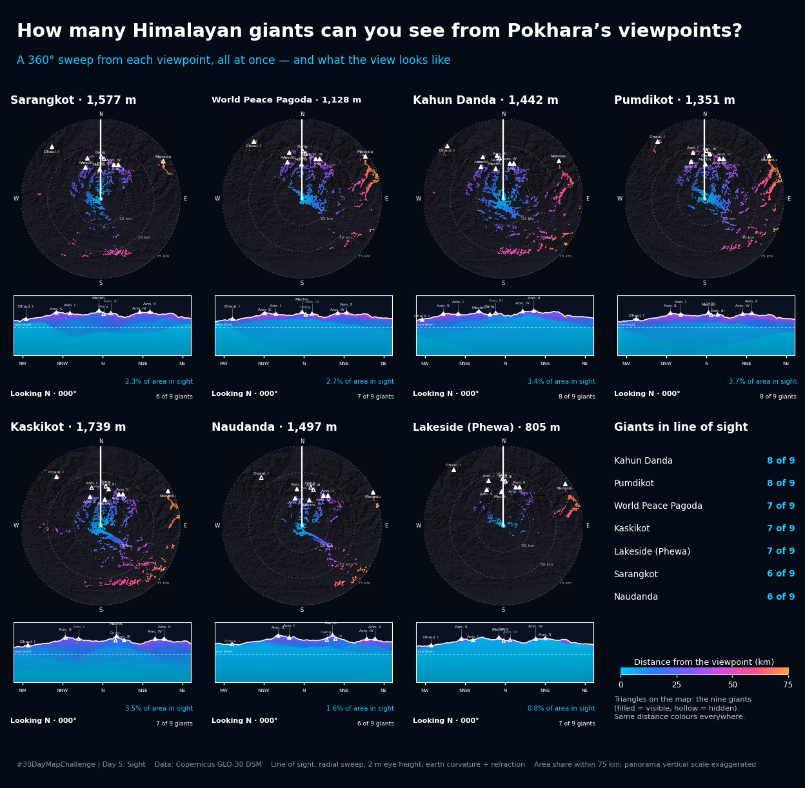

# Sight: how many Himalayan giants can you see from Pokhara?

A 360-degree line-of-sight study from seven established viewpoints in the Pokhara valley (Nepal)
to nine Himalayan summits, animated as a sweep. Made for #30DayMapChallenge 2026, Day 5 ("Sight").



**Live page:** https://pratyush-dh.github.io/projects/pokhara-sight/ (plays the animation)

## What it shows

- **Sweep map (top of each panel):** a circle of 75 km round the viewpoint. A line rotates clockwise
  from north and lights up the ground that has a line of sight to the viewpoint, coloured by distance.
- **Panorama (below it):** what the horizon looks like in the current heading, with the terrain layers
  coloured by distance. The vertical scale is exaggerated. The nine giants are marked (filled =
  visible, hollow = hidden).
- **Counters:** the heading, the share of the mapped area in sight so far, and how many giants have
  come into view.

## Results

Giants in line of sight (of 9: Dhaulagiri I, Annapurna I, II, III, IV and South, Machhapuchhre,
Gangapurna, Manaslu):

| Viewpoint | DEM height | Giants | Which |
|---|---|---|---|
| Kahun Danda | 1,442 m | 8 | all but Annapurna III |
| Pumdikot | 1,351 m | 8 | all but Gangapurna |
| World Peace Pagoda | 1,128 m | 7 | all but Annapurna III, Gangapurna |
| Kaskikot | 1,739 m | 7 | no Annapurna I, Gangapurna |
| Lakeside (Phewa) | 805 m | 7 | all but Annapurna III, Gangapurna |
| Sarangkot | 1,577 m | 6 | no Annapurna III, Gangapurna, Manaslu |
| Naudanda | 1,497 m | 6 | no Dhaulagiri I, Annapurna III, Gangapurna |

The full list per viewpoint is in [`data/viewpoints.csv`](data/viewpoints.csv). The overview map
([`media/overview-map.png`](media/overview-map.png)) shows how many giants are in sight from every
cell of the valley: the flat valley floor has a median of 7 giants in sight and some cells see all nine,
while about 58% of the mapped window sees at least one.

## Method

1. **DEM:** Copernicus GLO-30 (a *surface* model, so it includes canopy and buildings), streamed from
   the public AWS bucket and warped to UTM 44N at 30 m (bilinear).
2. **Line of sight:** for a viewpoint and a summit, the terrain is sampled along the straight path and
   compared with the sight line. Earth curvature and refraction subtract `0.85714 * d * (D - d) / 2R`
   from the sight line. The observer is 2 m above the ground; the target is the summit cell.
3. **Sweep and panorama:** for each azimuth (0.075 degree steps) the terrain is sampled every 40 m to
   75 km. A ground cell is visible if its elevation angle is at least the running maximum of everything
   nearer along the ray. The panorama is the same data: each elevation angle shows the nearest surface
   that reaches it.
4. **Summits and viewpoints** are snapped to the highest DEM cell within a radius and their DEM
   height is checked against the published height. Anything that fails is skipped, not plotted.

I first tried `gdal_viewshed` from each summit, assuming line of sight is reciprocal. It is not, for
grazing lines in GDAL: the Sarangkot-Machhapuchhre line was visible one way and hidden the other, and
the whole Pokhara window came out empty. The explicit line-of-sight test above replaced it.

## Caveats

- **Geometric only.** No haze, cloud or atmospheric extinction: this is "could you see it", not
  "will you see it". Pokhara's famous views are mostly clear-air mornings.
- **Marginal lines.** Annapurna II (about 35 km, behind Annapurna IV) grazes a ridge. Two DEMs built
  from the same tiles differed by about 0.1 m and that was enough to flip it at Sarangkot and Kahun
  Danda, so treat the counts as plus or minus one.
- **Surface model.** Canopy and buildings can hide a line that is open on bare ground, and bilinear
  resampling lowers sharp summits by 50 to 130 m, which biases the result slightly toward "hidden".
- **Viewpoint coordinates** come from Google Maps pins (Pumdikot Shiva statue, Naudanda View Tower),
  Wikipedia (World Peace Pagoda) and tourism listings (Sarangkot); Kahun Danda and Kaskikot are
  snapped from area-level points to the ridge top. Each is checked against its published height.
- Counts are for the nine summits chosen here, not all peaks in view.

## Reproduce

```
conda install -c conda-forge gdal rasterio scipy pyproj matplotlib numpy pillow
pip install imageio-ffmpeg
python scripts/day05_sight_pokhara.py            # DEM download, table, overview map, panoramas
python scripts/day05_sight_pokhara_anim.py grid  # the animation, MP4 + GIF
```

Outputs go to `./day05_sight/`. The first run downloads four DEM tiles (about 100 MB once). The map
script takes roughly 12 minutes and the animation about 10. `python scripts/day05_sight_pokhara_anim.py
single Sarangkot` renders one viewpoint on its own.

## Credits

- Elevation: *Contains modified Copernicus DEM GLO-30 data* (c) DLR e.V. 2010-2014 and (c) Airbus
  Defence and Space GmbH 2014-2018, provided under COPERNICUS by the European Union and ESA.
- The sweep-plus-panorama layout is inspired by Sara Aharon's Day 5 entry (a viewshed from Moldoveanu
  Peak, Romania): https://www.linkedin.com/posts/saraaharon_30daymapchallenge-day5-sight-ugcPost-7524002632420634624-K4tg
  The code, data and results here are my own.
